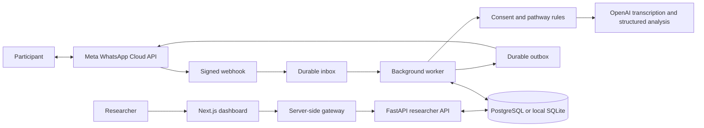

# AI Deployment Projects

A portfolio of working prototypes with readable code, documented decisions, and explicit verification limits.

| Project | Try it | Source and status |
| --- | --- | --- |
| **Dockflow** — inbound operations simulator | [Public live demo](https://dockflow-inbound-lab-olami-1110.boileditem.chatgpt.site) | [Code, setup and walkthrough](dockflow/README.md). Synthetic data; deterministic priorities and compatible door proposals; simulated operator approval, undo and exports. |
| **Echo** — WhatsApp research interviewer | Local setup below | [Architecture and setup](#echo). Implemented prototype; live WhatsApp interview and transcription remain unverified. |

## Echo

[](https://github.com/olamitisoji/AI-Deployment-Projects/actions/workflows/checks.yml)

**A WhatsApp-first research interviewer with a researcher workspace.**

Research interviews need consistency without becoming rigid scripts. Echo lets a researcher define an objective, required information, and bounded follow-ups, then review the conversation and the evidence behind each decision. Participants answer through WhatsApp; researchers design and inspect studies in a separate dashboard.

### Status

This is an implemented prototype with automated integration coverage and a verified cloud PostgreSQL connection. **A real WhatsApp interview has not been completed.** The API, worker, and dashboard currently run locally; hosted researcher authentication, live transcription, real-device delivery, and commercial eligibility remain unverified. No participant interviews are included.

Implemented:

- Editable study pathways, explicit approval, frozen interview guides, and expiring general or single-use personalized invitation links.
- AI disclosure and consent before audio processing; pause, resume, skip, stop, withdrawal, and human-support commands.
- Structured model analysis bounded by application-owned rules, coverage evidence, follow-up limits, and readable decision reasons.
- Signed Meta webhooks, duplicate suppression, durable inbox/outbox processing, response-window checks, delivery reconciliation, and no automatic replay of uncertain sends.
- Encrypted participant content, project membership checks, retention and withdrawal deletion, transcript/decision inspection, JSON export, and source-linked extractive review.

AI adapters call real services when configured. The quickstart below disables them; configuration errors are surfaced rather than replaced with generated demonstration answers. The extractive view does not claim that themes or population-level findings have been established.

### Architecture



The model supplies schema-validated analysis and evidence; application code controls consent, transitions, budgets, persistence, and sending. Downloaded audio is decoded in memory and is not retained as an Echo audio file. Provider handling and external exports have separate retention limits.

**Stack:** Python, FastAPI, Pydantic, SQLAlchemy, PostgreSQL/Supabase, Next.js, TypeScript, React, Meta Cloud API, OpenAI, and FFmpeg-based audio normalization.

### Local quickstart

Requires **Python 3.13+**, **Node.js 22.13+**, and a POSIX shell. Clone this repository and run from its root directory. No Supabase, Meta, or OpenAI account is required to inspect the dashboard, edit the seeded draft, or run the automated tests.

```sh
git clone https://github.com/olamitisoji/AI-Deployment-Projects.git
cd AI-Deployment-Projects
python3 -m venv .venv
.venv/bin/python -m pip install -r backend/requirements.lock
.venv/bin/python scripts/configure_local.py
cd backend
ECHO_ENV_FILE=.env OPENAI_API_KEY= OPENAI_KEY_FILE= ../.venv/bin/python -m echo.manage init-db
ECHO_ENV_FILE=.env OPENAI_API_KEY= OPENAI_KEY_FILE= ../.venv/bin/python -m echo.manage seed-study
ECHO_ENV_FILE=.env OPENAI_API_KEY= OPENAI_KEY_FILE= ../.venv/bin/python -m uvicorn echo.api:app_factory --factory --host 127.0.0.1 --port 8000 --no-access-log
```

In a second terminal, from the Echo project directory:

```sh
cd backend
ECHO_ENV_FILE=.env OPENAI_API_KEY= OPENAI_KEY_FILE= ../.venv/bin/python -m echo.worker
```

In a third terminal, from the Echo project directory:

```sh
cd dashboard
npm ci
npm run dev -- --port 3002
```

Open [the dashboard](http://127.0.0.1:3002) or [the local API explorer](http://127.0.0.1:8000/docs). The setup script generates private local credentials and connects the dashboard gateway without printing the token. It preserves existing settings. The seed creates an **unapproved healthcare-administration research draft**, not participant responses. The worker waits until WhatsApp is configured; invitation creation reports missing Meta configuration. Keep local credential access on loopback.

### Verification

From `backend`:

```sh
../.venv/bin/python -m pytest -q
```

From `dashboard`:

```sh
npm test
npm run typecheck
npm run build
```

Latest local verification: **132 backend tests and 10 dashboard gateway tests passed**. TypeScript validation passed, and a production build passed from an isolated source copy without private environment settings (using the already-installed dependencies). The [first GitHub Actions run](https://github.com/olamitisoji/AI-Deployment-Projects/actions/runs/42875028190) also passed both jobs: backend installation/tests and dashboard installation/tests/build/typecheck. The [workflow](.github/workflows/checks.yml) runs on pushes and pull requests without provider secrets. The joined offline flow covers consent, audio/provider boundaries, follow-up decisions, replay suppression, controls, completion, export after restart, and withdrawal. Provider test doubles do not establish live WhatsApp or model quality. See the [verification record](docs/VERIFICATION.md) for the exact scope and remaining checks.

### Read further

- [Conversation engine and boundaries](docs/ENGINE.md)
- [Research-quality evaluation](docs/EVALUATION.md)
- [Meta test setup](docs/META_SETUP.md)
- [Deployment, secrets, and production prerequisites](docs/DEPLOYMENT.md)
- [Supabase schema and restricted runtime access](supabase/README.md)
- [Dashboard setup](dashboard/README.md)

Next milestones are a verified real-device interview, research-quality evaluation, contact recruitment with recorded opt-in, and richer evidence-linked synthesis. Hosted authentication, privacy/support operations, and commercial messaging eligibility require separate verification before participant research.
