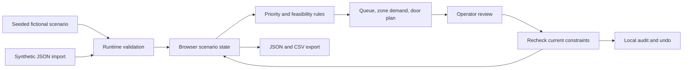

# Dockflow

[Open the public demo](https://dockflow-inbound-lab-olami-1110.boileditem.chatgpt.site) · [Automated checks](https://github.com/olamitisoji/AI-Deployment-Projects/actions/workflows/dockflow.yml)

An independent inbound-operations simulator: prioritize fictional trailers, inspect destination demand, and review compatible dock-door proposals before accepting a simulated assignment.

This project demonstrates operational decision support with deterministic rules. All facilities, carriers, loads, capacities and policies are synthetic. It contains no employer source code, operational records, service endpoints or integrations. It is not a production warehouse control system, an optimal scheduler or evidence of historical business impact.

## Operator loop

1. Load a reproducible scenario and inspect current/next-deadline freight.
2. See destination demand, physical door occupancy, and data-quality exceptions.
3. Select a waiting trailer and read why a door is feasible or why the trailer is blocked.
4. Accept a proposal or select another eligible door; every action revalidates the current state.
5. Inspect the audit event, mark a trailer unloaded, undo, or export the synthetic snapshot.

Priority never overrides handling or destination compatibility. Holds never make a physically occupied door available. Missing or stale profiles remain explicit uncertainty. A recommendation itself changes no assignment.

## Architecture



The core is plain TypeScript. React renders its results using the Sites/Vinext starter. No model API, database account or business-system access is required. State persists in the current browser; it is not shared across users or devices. The hosted demo is public and requires no sign-in. Each visitor has separate browser-local simulation state.

- `lib/dock-types.ts`: explicit input, output and action types.
- `lib/dock-engine.ts`: validation, priority, feasibility, proposals, actions and export.
- `lib/dock-fixtures.ts`: repeatable synthetic scenarios.
- `components/dock-dashboard.tsx`: interactive operator workflow.
- `tests/dock-engine.test.mjs`: behavioral and constraint checks.

## Run locally

Requires Node.js 22.13 or newer. Clone the portfolio repository, then enter this folder:

```sh
git clone https://github.com/olamitisoji/AI-Deployment-Projects.git
cd AI-Deployment-Projects/dockflow
npm ci
npm run dev
```

Open the local URL printed by the server. The default portable preview port is 5173. No credentials need to be entered for local simulation.

```sh
npm test
npm run typecheck
npm run build
```

## Rules and limits

The [design](docs/DESIGN.md) specifies the fictional rules and metric definitions. Arrival-order and priority-order planning are greedy comparisons; neither is claimed to be globally optimal. Destination pressure and projected physical workload are different synthetic ratios, not measured throughput or utilization. The simulated clock uses minutes on one fictional day, with no calendar, timezone or daylight-saving claim.

Staffing, live feeds, real dispatch, external write-back, multi-user audit, calendar scheduling and measured operating outcomes are outside this first slice. Any historical work story must have separate evidence and must not reuse this demo's results as real impact.

Read [LEARNING.md](LEARNING.md) for a plain-language walkthrough and [VERIFICATION.md](docs/VERIFICATION.md) for the checked behavior and remaining limits.

## Publication and portability

This folder contains the independent simulator and the licensed Sites/Vinext starter it uses. The public configuration has no Site identity or credentials. Local development and tests require no account; deploying your own copy requires a separate hosting setup. The included vendor license files cover the retained starter assets.
